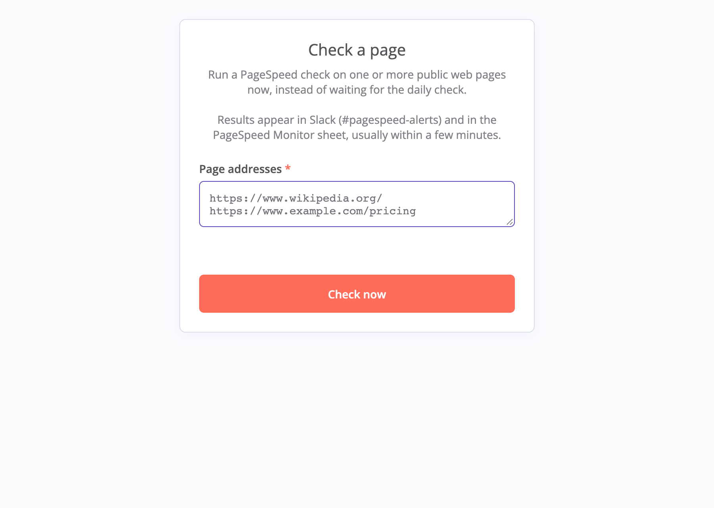
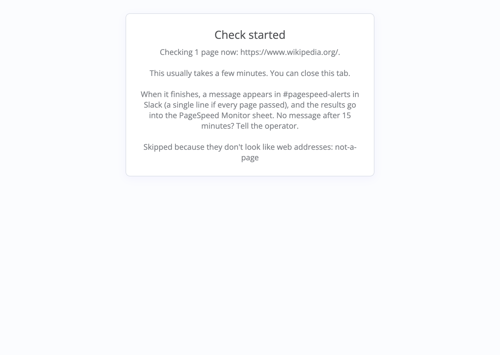

# PageSpeed Monitor: VA guide

*What you need for your first week on PageSpeed alerts. The other files in this folder go into more detail.*

> Demo setup: the daily check is switched off for now. The form works.

---

## What the monitor does

The PageSpeed Monitor checks how fast a list of web pages loads, using Google's free PageSpeed tool. It tests each page 3 times as a phone and 3 times as a computer and averages the scores, because one test on its own jumps around.

A page gets flagged if it's slow, or if Google finds a fix that would make it noticeably faster. Each flagged page comes with a short explanation and a risk level (`low`, `medium` or `high`). After every check the monitor posts one message in Slack.

You don't run anything technical. You read the results, look up what to do in the table, and tell the right person.

| You want to… | Use | You get |
|---|---|---|
| See how the pages did today | The digest in `#pagespeed-alerts` | One Slack message after every check |
| Check a page right now | The "Check a page" form | A digest a few minutes later |
| See the details or the trend | The PageSpeed Monitor Google Sheet | Every score from every check |
| Know what to do | [what-to-do.md](what-to-do.md) | The table, message templates and the escalation log |

---

## 1. The digest

Once a day the monitor checks its list of pages and posts one message, the digest, to `#pagespeed-alerts`. The check runs at 07:00 on the operator's computer, so ask them what time that is for you. A form check posts a digest too, and it looks the same.

You get a digest after every check, even when nothing's wrong. If every page passed, it's one line:

```
✅ PageSpeed Monitor: all 7 pages passed
```

> If there's no digest an hour after the daily check time, something broke. Tell the operator ([how](what-to-do.md#no-digest)).

When a page needs attention, it looks like this (shortened):

```
PageSpeed Monitor: 1 of 1 page needs attention · 1 page couldn't be tested

🔴 https://www.theverge.com/: high risk · mobile 27 · desktop 53
The Verge scores poorly: 27/100 on mobile and 53/100 on desktop. ...
Quick win: Add fetchpriority="high" (and remove lazy-loading) on the main hero image, ...

❌ https://this-domain-does-not-exist.invalid/: no PageSpeed data (6 failed runs)

Run 31 · details in the PageSpeed Monitor sheet (findings, history and errors tabs)
```

From the top:
1. The headline: how many pages need attention, and how many couldn't be tested.
2. One block per flagged page, highest risk first: 🔴 `high`, 🟠 `medium`, 🟡 `low`.
3. Scores are out of 100. The target is 90 or more.
4. ❌ lines are pages the monitor couldn't test. That isn't the same as slow ([what to do](what-to-do.md#a-page-could-not-be-tested)).
5. The footer has the run number. Use it to find this check in the Sheet, and put it in anything you send the operator.

Every line is explained in [reading-the-digest.md](reading-the-digest.md).

---

## 2. The "Check a page" form

You'll use this to re-check a page before you report it, or when someone asks whether a page is slow.

1. Open the form. The operator will give you the address. In the demo setup it's http://localhost:5678/form/check-a-page, which only opens on the computer the monitor runs on, so you'll need the operator's screen.
2. Paste up to 10 page addresses, one per line. Each one needs to start with `https://` (or `http://`).
3. Click **Check now**.

   

4. You'll see "Check started" and the list of pages being checked. You can close the tab.

   

5. The digest turns up in Slack, usually within a few minutes. A slow page can take up to 15.

If the form says "Nothing was checked", it tells you why. Fix the addresses and try again ([example](images/form-nothing-checked.png)). If only some entries were wrong, the rest still get checked and the wrong ones are listed as skipped.

Can't open the form? Tell the operator once. Until it's fixed, the next daily check is your re-check. Don't use pagespeed.web.dev instead, because it scores pages differently. Its only use here is checking whether Google can test a ❌ page at all ([steps](what-to-do.md#a-page-could-not-be-tested)).

---

## 3. What to do about it

These are the everyday cases. Before you send anything, use the [full table](what-to-do.md), which has every case and the message templates.

| You see… | Do this |
|---|---|
| ✅ passed, or 🟡 low | Nothing. Low is never reported on its own |
| 🔴 on a page that isn't in the escalation log at 🔴 | Re-check it once. If it's still 🔴, message the client contact today (template A, or B if they've already heard about it) and update the log |
| 🟠 on a page that isn't in the log | Re-check it once. If it's still 🟠, add a log row. It goes in Monday's weekly report, not a message today |
| 🔴 or 🟠, already in the log at the same risk or higher | Nothing today. It goes in Monday's weekly report |
| ❌ *could not be tested* | Open the page yourself, then [follow these steps](what-to-do.md#a-page-could-not-be-tested) |
| 🚨, *(error summary)*, *(fallback summary)* on every flagged page, or no digest | Tell the operator today |

Only 🔴 pages and pages that are down reach a client the same day, and each client gets at most one message a day. Everything else waits for Monday's weekly report.

React 👀 on a digest when you pick it up and ✅ when you're done. If someone else's 👀 is already on it, leave it to them. When your re-check digest arrives, react 👀 on it so nobody else picks it up.

---

## Troubleshooting

| You see… | Meaning | Do this |
|---|---|---|
| The form page won't load | The monitor isn't running, or you can't reach it from your computer | Tell the operator once |
| "Nothing was checked" | The box was empty, nothing in it was a web address, or there were more than 10 | Check each address starts with `https://`, put one per line, and send no more than 10 |
| Clicked **Check now**, no digest after 15 minutes | The check is stuck or broke | Tell the operator when you sent it and which pages |
| A digest whose run number isn't in the Sheet | The results didn't reach the Sheet | Tell the operator |
| 🚨 *PageSpeed Monitor failed at…* | The monitor itself broke, not a web page | Paste the message to the operator |

Use the digest to see what's slow and the Sheet to see how slow it is and since when. The table tells you what to do about it. If the monitor itself is broken, pass it to the operator.

---

## Words and people

The [glossary](glossary.md) explains digest, flagged, risk, could not be tested, fallback, run, operator and escalation log.

A question about a web page (it's slow, what a finding means) goes to the client contact for that site. Your lead has the list. A question about the monitor (no digest, form broken, error messages) goes to the operator, with the run number and a screenshot of the Slack message. They work from the [runbook](https://github.com/dexterloor/pagespeed-monitor/blob/main/docs/runbook.md). If you're not sure which, ask your lead.
